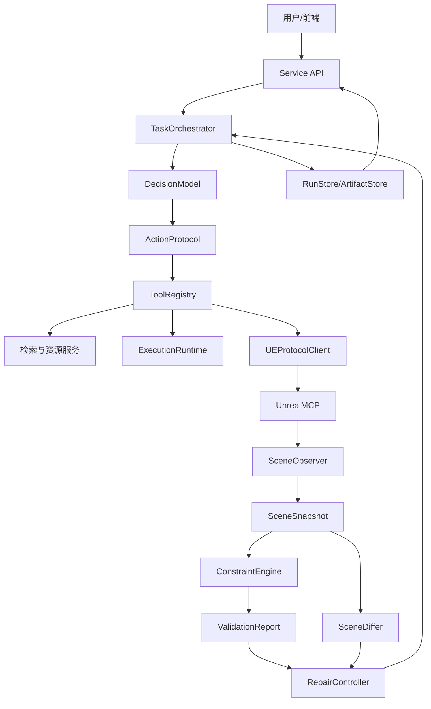
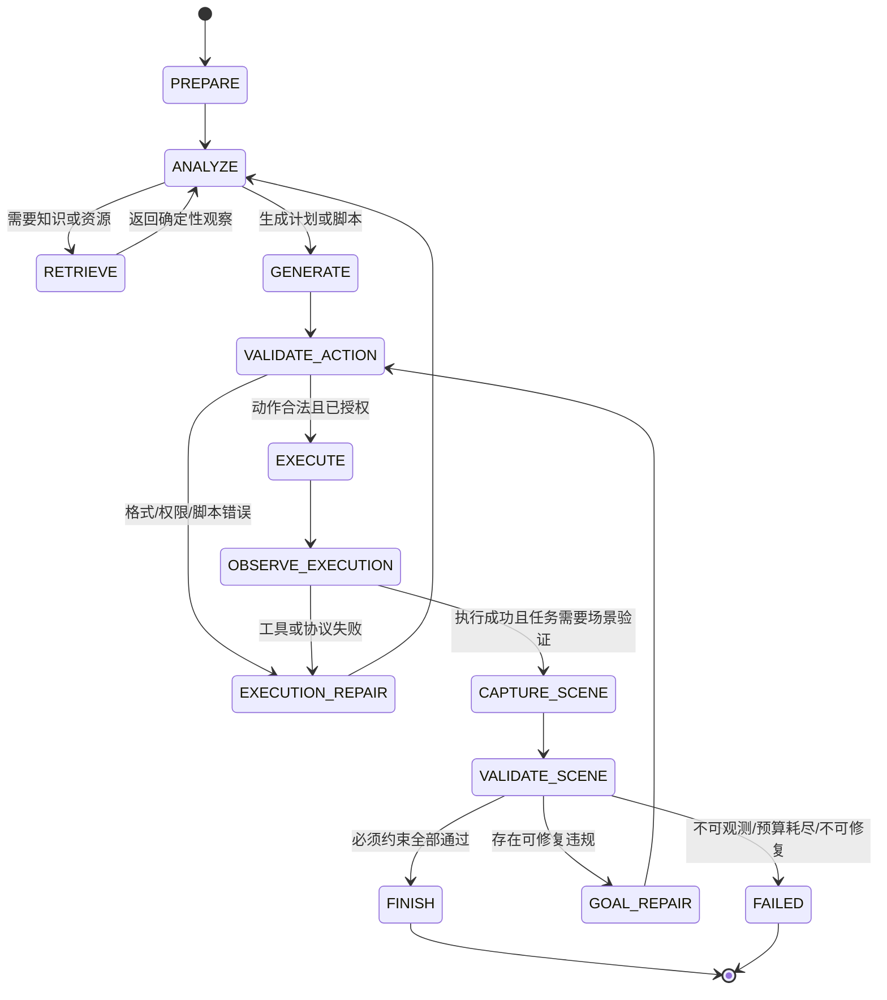

# LCAgent 优化改造具体说明（v1）

制定日期：2026-10-21

适用工程：`E:\LCAgent`

关联文档：`LCAgent通用验证与修复能力优化方案_v1.md`

## 1. 文档定位

《LCAgent通用验证与修复能力优化方案》回答的是“按什么阶段实施、每一阶段如何验收”。本文进一步回答以下问题：

- 当前 LCAgent 的能力边界究竟在哪里；
- 为什么现有 `VALIDATE/OBSERVE/REPAIR` 还不是场景验证闭环；
- 优化后各模块分别负责什么；
- 模型、确定性程序和 UE 插件之间怎样交换数据；
- “执行成功”“验证通过”和“任务完成”如何区分；
- 场景尚未确定时，哪些接口可以先稳定下来；
- 后续具体任务怎样在不修改主循环的前提下接入。

本文是工程设计说明，不代表这些能力已经实现。文中所有新增接口和数据结构均需在另一开发工程中编码、测试，并在真实 UE 环境中核验。

## 2. 当前系统究竟做到了什么

现有 LCAgent 已经具备一条基础执行链：

```text
用户任务
  → API 大模型生成结构化动作
  → 检索知识或资源
  → 生成受控 Python 脚本
  → AST 与资源权限检查
  → dry-run 或 live 执行
  → 把工具返回交给同一模型
  → 模型决定继续、修正或结束
```

相关实现主要位于：

- `LCA/Agent.py`：状态机、动作调度、模型循环和轨迹；
- `LCA/prompt_template.py`：允许动作与安全要求；
- `LCA/execution_runtime.py`：脚本写入、AST 校验和执行；
- `LCA/retrieval_service.py`：知识与资源检索；
- `LCA/ue_protocol.py`：UE 协议和能力握手；
- `LCA/service.py`：本地 HTTP 服务；
- `UnrealMCP-master/`：UE 侧命令处理器。

这套系统已经能够解决三类问题：

1. 模型输出是否是合法动作；
2. 脚本是否满足安全和语法边界；
3. 工具调用或 UE 命令是否返回错误。

但它还没有完整解决第四类问题：

> UE 没有报错，是否就代表用户要求的场景已经真实完成？

答案是否定的。UE 命令成功只说明某个接口完成了调用，不保证对象数量、属性、相互关系或任务功能符合目标。

## 3. 本轮优化要解决的核心语义问题

### 3.1 三种“成功”必须分开

优化后必须明确区分：

| 层级 | 含义 | 判定主体 |
|---|---|---|
| 调用成功 | 请求格式正确，工具或 UE Handler 正常返回 | 工具适配器/协议客户端 |
| 执行成功 | 预期写操作已被 UE 接受并执行 | UE Handler 与执行层 |
| 任务成功 | 执行后的真实场景满足全部必须约束 | 确定性验证器与终止策略 |

前两项通过不能自动推出第三项通过。

### 3.2 两种“修复”必须分开

当前 `REPAIR` 主要处理：

- 模型 JSON 解析失败；
- 动作名称或参数错误；
- 脚本校验失败；
- 工具或协议调用异常。

这类问题应命名为“执行链修复”或 `execution_repair`。

优化后新增的是“任务级场景修复”或 `goal_repair`：

- 工具调用已经成功；
- 重新读取真实场景；
- 确定性验证发现目标仍未满足；
- 系统把结构化违规证据交给模型；
- 模型只能在允许范围内修改；
- 修改后再次读取和验证。

两者必须采用不同事件类型、统计指标和终止原因。

### 3.3 模型不再拥有最终判定权

优化后，模型仍负责：

- 理解用户意图；
- 选择检索与工具；
- 生成计划和脚本；
- 根据失败证据提出修复动作；
- 生成面向用户的解释。

模型不负责：

- 伪造 UE 状态；
- 自行判断某项约束已经满足；
- 在没有场景快照时宣布任务完成；
- 绕过保护对象或修复预算；
- 把不可观测字段当作通过。

最终成功状态由编排器依据确定性验证报告生成，而不是由模型的一句 `finish` 决定。

## 4. 优化后的总体架构



架构中的三条控制边界是：

1. 模型输出必须经过 `ActionProtocol` 和 `ToolRegistry`；
2. UE 返回必须经过 `SceneObserver` 标准化，不能直接由模型解释为成功；
3. 修复动作必须经过 `RepairController` 的范围和预算检查。

## 5. 核心数据对象

下面的数据对象应优先以 JSON Schema 固化。Python 可以使用 dataclass 或其他轻量模型实现，但磁盘产物和服务接口应保持 JSON 兼容。

### 5.1 `ToolSpec`：工具的唯一事实来源

```json
{
  "name": "query_scene_state",
  "description": "按条件读取 UE 场景状态，不修改场景",
  "input_schema": "contracts/unreal_mcp/scene_query_request.schema.json",
  "output_schema": "contracts/unreal_mcp/scene_query_response.schema.json",
  "required_capabilities": ["scene.query.v1"],
  "effect": "read_only",
  "idempotent": true,
  "default_timeout_ms": 10000
}
```

`effect` 建议限定为：

- `read_only`：只读，可在明确规则下安全重试；
- `local_write`：仅写入 LCAgent 受控目录；
- `ue_write`：修改 UE 场景；
- `external_write`：修改其他外部系统，当前阶段原则上不使用。

提示词中的动作说明、运行时参数校验、能力检查和工具调度都应从 `ToolSpec` 生成，避免重复维护。

### 5.2 `ModelAction`：模型唯一允许输出的动作格式

```json
{
  "action": "query_scene_state",
  "arguments": {
    "filter": {"entity_ids": ["entity_001"]},
    "fields": ["identity", "transform", "bounds"]
  },
  "rationale": "需要取得真实状态后才能验证任务"
}
```

运行时只信任 `action` 和经过 Schema 校验的 `arguments`。`rationale` 用于审计，不作为权限依据。

### 5.3 `TaskRun`：一次完整任务运行

```json
{
  "run_id": "run_20261021_xxxx",
  "workspace_id": "...",
  "status": "running",
  "task_text": "...",
  "model_profile": "...",
  "execution_mode": "dry_run",
  "protocol_version": "2.0",
  "started_at": "...",
  "budgets": {
    "max_model_steps": 12,
    "max_execution_repairs": 3,
    "max_goal_repairs": 3,
    "max_tool_actions": 30,
    "max_elapsed_seconds": 600
  }
}
```

`TaskRun` 是服务重启后仍可查询的持久对象。任务面板和论文实验记录都应以它为索引。

### 5.4 `RunEvent`：不可变的运行事件

```json
{
  "run_id": "run_20261021_xxxx",
  "sequence": 7,
  "event_type": "scene_validation_completed",
  "phase": "VALIDATE_SCENE",
  "status": "failed",
  "timestamp": "...",
  "summary": {"failed": 1, "not_observable": 0},
  "artifact_refs": ["artifacts/validation_0001.json"]
}
```

事件应追加写入，不覆盖历史。大型模型内容、场景快照和验证报告保存为产物文件，事件只保存摘要与引用。

### 5.5 `SceneQuery`：通用场景查询

```json
{
  "filter": {
    "entity_ids": [],
    "names": [],
    "labels": [],
    "class_names": [],
    "tags": []
  },
  "fields": [
    "identity",
    "transform",
    "bounds",
    "asset_reference",
    "tags",
    "parent"
  ],
  "page_size": 200,
  "cursor": null
}
```

查询不是“返回全部 Actor”的别名。它必须支持过滤、字段投影和分页，避免大场景截断、网络负担和上下文膨胀。

### 5.6 `SceneSnapshot`：标准化后的真实状态

```json
{
  "snapshot_id": "snapshot_xxxx",
  "source": "unreal_editor",
  "level_id": "...",
  "captured_at": "...",
  "query": {},
  "completeness": {
    "complete": true,
    "truncated": false,
    "missing_fields": []
  },
  "coordinate_system": "UE_LHS_Z_UP",
  "linear_unit": "cm",
  "angle_unit": "degree",
  "entities": [
    {
      "entity_id": "entity_001",
      "name": "...",
      "class_name": "...",
      "asset_reference": "...",
      "transform": {
        "location": [0, 0, 0],
        "rotation": [0, 0, 0],
        "scale": [1, 1, 1]
      },
      "bounds": {
        "origin": [0, 0, 0],
        "extent": [50, 50, 50]
      },
      "tags": []
    }
  ]
}
```

关键要求：

- 单位和坐标系必须明确；
- 不能取得的字段不能填伪默认值；
- 查询被截断时必须显式标记；
- 实体 ID 的稳定范围必须说明；
- 快照应具有内容哈希，便于复核和去重。

### 5.7 `ConstraintSet`：任务成功条件

场景尚未确定时，先定义通用结构，不定义具体阈值：

```json
{
  "constraint_set_id": "constraints_xxxx",
  "version": "1.0",
  "required": [
    {
      "constraint_id": "c_001",
      "type": "property_range",
      "subjects": ["entity_001"],
      "parameters": {
        "property": "transform.location.x",
        "minimum": 0,
        "maximum": 1000
      },
      "required_observations": ["transform"]
    }
  ],
  "protected_entities": [],
  "tolerances": {}
}
```

`type` 对应注册到 `ConstraintEngine` 的确定性求值器。后续新增论文任务，只增加约束实例或新的 evaluator，不修改智能体主循环。

### 5.8 `ValidationReport`：确定性验证结果

```json
{
  "report_id": "validation_xxxx",
  "snapshot_id": "snapshot_xxxx",
  "constraint_set_id": "constraints_xxxx",
  "overall_status": "failed",
  "results": [
    {
      "constraint_id": "c_001",
      "status": "failed",
      "measured": {"value": 1200},
      "expected": {"minimum": 0, "maximum": 1000},
      "involved_entities": ["entity_001"],
      "evidence_refs": ["snapshot_xxxx#entity_001.transform"],
      "message": "属性值超出允许范围"
    }
  ],
  "summary": {
    "passed": 0,
    "failed": 1,
    "not_observable": 0,
    "error": 0
  }
}
```

每条约束结果只能属于：

- `passed`：证据充分且满足要求；
- `failed`：证据充分且不满足要求；
- `not_observable`：快照缺少判定所需字段或查询不完整；
- `error`：求值器内部异常或数据不合法；
- `skipped`：由明确策略跳过，只适用于非必须约束。

必须约束出现 `failed`、`not_observable` 或 `error` 时，任务均不能判定为成功。

### 5.9 `SceneDiff`：执行前后的结构化差异

```json
{
  "before_snapshot_id": "snapshot_before",
  "after_snapshot_id": "snapshot_after",
  "status": "comparable",
  "added_entities": [],
  "removed_entities": [],
  "modified_entities": [
    {
      "entity_id": "entity_001",
      "changes": [
        {
          "path": "transform.location.x",
          "before": 1200,
          "after": 900,
          "delta": -300
        }
      ]
    }
  ]
}
```

差异引擎必须支持：

- 数值容差；
- 忽略时间戳等易变字段；
- 区分“没有变化”和“数据不完整，无法比较”；
- 检查保护对象是否发生非预期变化。

### 5.10 `RepairRequest`：对模型的最小修复上下文

```json
{
  "run_id": "run_xxxx",
  "repair_index": 1,
  "failed_constraints": ["c_001"],
  "evidence_refs": ["validation_xxxx#c_001"],
  "allowed_entities": ["entity_001"],
  "protected_entities": ["entity_002"],
  "allowed_properties": ["transform.location"],
  "remaining_budget": {
    "goal_repairs": 2,
    "tool_actions": 8
  }
}
```

模型收到的不是整段冗长运行历史，而是与失败有关的最小上下文。执行前，程序必须检查动作的写集合是否超出 `allowed_entities/allowed_properties`。

## 6. 完整运行流程



### 6.1 准备阶段

编排器完成：

- 创建 `run_id`；
- 冻结模型配置、执行模式和预算；
- 检查 UE 握手和所需 capability；
- 记录协议版本与环境信息；
- 若任务带有约束集，先检查约束类型是否有 evaluator。

### 6.2 动作阶段

模型每次仍只返回一个动作，但动作依次经过：

1. JSON 提取；
2. `ModelAction` Schema 校验；
3. 工具是否存在；
4. 参数 Schema 校验；
5. UE capability 检查；
6. 副作用权限检查；
7. 修复范围检查；
8. 工具执行。

任一检查失败都不会调用 UE。

### 6.3 执行后观测阶段

工具返回成功后不能立即结束。若任务要求场景验证，编排器自动：

1. 生成 `SceneQuery`；
2. 通过 `SceneObserver` 取得快照；
3. 检查分页、截断、字段缺失和坐标单位；
4. 保存场景快照；
5. 调用 `ConstraintEngine`；
6. 保存验证报告。

### 6.4 任务级修复阶段

若验证失败且仍有预算：

1. 从失败约束提取涉及实体和证据；
2. 根据策略计算允许修改范围；
3. 构造 `RepairRequest`；
4. 模型提出一个修复动作；
5. 程序验证写集合；
6. 执行修复；
7. 重新取得场景快照；
8. 计算前后差异；
9. 检查保护对象；
10. 重新验证所有受影响约束。

不能只验证刚刚失败的单项约束，因为局部修改可能破坏原本已经通过的约束。

### 6.5 终止阶段

任务终止结果必须由编排器产生：

| 终止原因 | 对外状态 | 含义 |
|---|---|---|
| `goal_satisfied` | succeeded | 必须约束全部通过 |
| `constraint_failed` | failed | 存在未满足且不能继续修复的约束 |
| `not_observable` | failed | 缺少证明任务成功的必要状态 |
| `tool_error` | failed | 工具或 UE 执行错误未能恢复 |
| `budget_exhausted` | failed | 步数、时间、费用或修复次数耗尽 |
| `protocol_mismatch` | failed | 所需能力与实际插件不匹配 |
| `cancelled` | cancelled | 用户取消，停止发起新动作 |

模型输出的自然语言只负责解释终止结果，不能改变终止状态。

## 7. 各模块的具体职责

### 7.1 `ActionProtocol`

负责：

- 从模型回复中提取唯一 JSON 对象；
- 校验动作顶层结构；
- 拒绝多动作、未知字段和非对象输出；
- 生成统一的解析错误。

不负责：实际调用工具、判断场景是否成功。

### 7.2 `ToolRegistry`

负责：

- 注册 `ToolSpec` 和执行函数；
- 生成模型可见工具说明；
- 校验输入和输出；
- 检查 capability 和副作用等级；
- 记录工具耗时、状态和错误码。

不负责：决定下一步调用哪个工具。

### 7.3 `TaskOrchestrator`

负责：

- 推进运行状态；
- 控制模型和工具预算；
- 区分执行链修复和任务级修复；
- 决定何时查询、验证、修复或终止；
- 把所有步骤写入 `RunStore`。

这是优化后的核心，但不应包含某类道路、建筑或地形的业务规则。

### 7.4 `SceneObserver`

负责：

- 将标准 `SceneQuery` 转换成 UE 请求；
- 处理分页；
- 将不同插件版本的返回适配成统一快照；
- 检查字段完整性、单位、坐标系和截断；
- 明确标记无法取得的信息。

不负责：判断约束是否满足。

### 7.5 `ConstraintEngine`

负责：

- 根据 `type` 找到 evaluator；
- 检查所需观测字段；
- 执行确定性计算；
- 产生测量值、期望值和证据引用；
- 汇总验证状态。

不允许调用聊天模型，也不允许偷偷补全缺失数据。

### 7.6 `SceneDiffer`

负责：

- 对齐两个快照中的实体；
- 按容差计算属性变化；
- 标记新增、删除、修改和无法比较；
- 为保护对象检查提供证据。

### 7.7 `RepairController`

负责：

- 从验证失败生成修复边界；
- 维护允许修改和保护集合；
- 检查拟执行动作的写集合；
- 管理修复预算；
- 检查修复后是否产生无关副作用。

不负责：替代模型生成所有具体修复代码。

### 7.8 `RunStore/ArtifactStore`

负责：

- 保存运行元数据和不可变事件；
- 保存快照、验证报告、差异、脚本和日志；
- 提供服务重启后的查询；
- 对敏感信息脱敏；
- 为论文实验导出可复核数据。

## 8. UE 协议优化的具体含义

### 8.1 统一请求

```json
{
  "protocol_version": "2.0",
  "request_id": "req_xxxx",
  "method": "query_scene_state",
  "data": {}
}
```

### 8.2 统一成功响应

```json
{
  "request_id": "req_xxxx",
  "status": "success",
  "result": {},
  "server_metadata": {
    "plugin_version": "...",
    "engine_version": "...",
    "duration_ms": 15
  }
}
```

### 8.3 统一错误响应

```json
{
  "request_id": "req_xxxx",
  "status": "error",
  "error": {
    "code": "CAPABILITY_NOT_SUPPORTED",
    "message": "...",
    "retryable": false,
    "details": {}
  }
}
```

推荐错误码至少包括：

- `INVALID_REQUEST`；
- `SCHEMA_MISMATCH`；
- `CAPABILITY_NOT_SUPPORTED`；
- `ENTITY_NOT_FOUND`；
- `QUERY_TRUNCATED`；
- `EDITOR_NOT_READY`；
- `EXECUTION_FAILED`；
- `TIMEOUT`；
- `INTERNAL_ERROR`。

只有只读且幂等的请求可以按明确策略自动重试。有副作用命令发生超时后，必须先查询真实状态，不能盲目重复执行。

## 9. 服务接口与前端表现

### 9.1 服务接口

建议新增：

```text
POST /api/runs
GET  /api/runs/{run_id}
GET  /api/runs/{run_id}/events?after_sequence=N
POST /api/runs/{run_id}/cancel
GET  /api/runs/{run_id}/artifacts
GET  /api/ue/capabilities
POST /api/ue/scene/query
```

现有 `/api/tasks` 暂时作为兼容入口，内部调用新的运行系统。待 Electron 和调用方全部迁移后再考虑弃用。

### 9.2 前端必须展示的状态

- 运行 ID；
- dry-run/live；
- 当前阶段；
- UE 是否连接以及协议/插件版本；
- 模型步骤、工具动作和剩余预算；
- 脚本校验状态；
- 场景观测完整性；
- 场景验证状态；
- 修复次数和最近一次差异；
- 最终终止原因。

界面不能只显示一个模糊的“成功”。至少应区分：工具执行成功、等待场景验证、验证通过、验证失败和不可观测。

## 10. 运行产物组织

建议按运行隔离：

```text
.lca_data/
  runs/
    run_xxxx/
      run.json
      events.jsonl
      artifacts/
        model_step_0001.json
        tool_observation_0001.json
        generated_script_0001.py
        scene_snapshot_before.json
        scene_snapshot_after.json
        validation_0001.json
        scene_diff_0001.json
      manifest.json
```

`manifest.json` 保存文件哈希、Schema 版本和生成时间。API Key、Authorization、完整环境变量及用户密码不得写入产物。

## 11. 与现有代码的兼容关系

### 11.1 `Agent.py`

第一阶段保留 `DecisionAgent` 外部接口，将动作解析和调度逐步委托给 `ActionProtocol`、`ToolRegistry`。等新 `TaskOrchestrator` 稳定后，再让 `DecisionAgent` 成为兼容包装器。

### 11.2 `prompt_template.py`

保留系统原则，但动作清单改为从 `ToolRegistry` 渲染。提示词不再手工维护每个动作的参数结构。

### 11.3 `execution_runtime.py`

继续负责脚本安全与执行，不把场景验证塞进该模块。脚本执行结果和场景状态是两个不同的数据源。

### 11.4 `ue_protocol.py`

增加 v2 信封、错误码、查询分页和能力详情；保留旧协议 fallback，但 fallback 产生的观测能力必须显式降级。

### 11.5 `service.py`

保留现有接口，同时增加运行资源接口。长期运行不得继续阻塞一个同步 HTTP 请求。

### 11.6 Streamlit 与 Electron

Streamlit 暂作为调试和管理入口；新任务生命周期优先在服务层实现，再迁移到 Electron。不要分别在两个前端复制业务逻辑。

## 12. 场景尚未确定时能完成哪些工作

现在可以完成：

- 工具注册表和动作 Schema；
- 运行 ID、事件和产物持久化；
- UE 能力发现与协议统一；
- 通用实体查询；
- transform、bounds、资源路径、tags 等基础快照；
- 快照完整性和差异计算；
- 约束 evaluator 注册机制；
- 通用存在、数量、属性范围和引用有效性约束；
- 修复范围、保护集合和预算控制；
- 假 UE 服务器上的端到端闭环测试。

需要等具体场景确定后再完成：

- 哪些实体必须出现；
- 哪些空间关系具有任务意义；
- 阈值和容差取值；
- 道路连通、视线、可达性等领域 evaluator；
- 任务集、故障注入和论文实验分组。

这种拆分能够避免工程层把尚未确定的论文假设写死。

## 13. 测试说明

### 13.1 单元测试

- 动作 Schema 合法与非法样例；
- 工具能力和副作用检查；
- 快照字段、单位与完整性；
- 数值容差和实体对齐；
- 约束五种求值状态；
- 修复范围与保护对象；
- 终止策略。

### 13.2 契约测试

Python 客户端和 C++ Handler 使用同一组固定 JSON 样例。任何一侧修改 Schema，都必须让测试明确失败，而不是依靠人工发现。

### 13.3 集成测试

使用假模型网关和假 UE 服务器测试：

1. 首次执行后验证通过；
2. 首次执行成功但场景验证失败；
3. 一次局部修复后通过；
4. 修复越权被拒绝；
5. 查询截断导致 `not_observable`；
6. 预算耗尽；
7. 用户取消；
8. 服务重启后读取历史运行。

### 13.4 真实 UE smoke test

不需要先确定论文场景。可以使用临时测试关卡验证：

- 握手和能力列表；
- 过滤与分页查询；
- 静态场景重复查询一致性；
- 一次受控属性修改；
- 修改前后快照和差异；
- 一条通用属性约束的失败与通过。

这里的临时对象只用于验证基础设施，不代表正式论文任务。

## 14. 安全与可靠性说明

- 查询类工具默认只读；
- live 写操作必须保留显式授权；
- 模型不能提供任意文件路径或任意 shell 命令；
- UE 资源路径继续受资源注册表约束；
- 有副作用动作超时后先查询状态，不自动重复执行；
- 每次修复都限制写集合；
- 保护对象变化导致验证失败；
- 所有循环都有步数、时间和费用预算；
- 所有日志进行 secret 脱敏；
- 查询不完整和协议降级都必须出现在最终结果中。

## 15. 优化完成后的预期变化

| 优化前 | 优化后 |
|---|---|
| 动作列表由代码和提示词重复维护 | 动作 Schema 和提示由工具注册表统一生成 |
| 一次 HTTP 请求同步等待任务完成 | 每次任务有持久化运行 ID 和事件链 |
| UE 返回成功后由模型决定是否结束 | 执行后读取真实场景并由验证策略决定 |
| 主要处理脚本或工具错误 | 区分执行链修复和任务级场景修复 |
| `get_scene_info` 返回有限 Actor 摘要 | 通用过滤、字段投影、分页和完整性标记 |
| 没有标准场景差异 | 修复前后快照可比较、可审计 |
| 模型可能直接输出完成 | 必须通过成功门，无法绕过验证 |
| 轨迹主要存在于当次响应 | 运行、事件和产物可长期复核 |

## 16. 与论文研究的关系

这次工程优化本身不能全部直接宣称为论文创新。工具注册、运行持久化、协议统一和日志属于支撑系统建设。

它们的作用是为后续真正的研究问题提供可信实验平台：

- 目标状态如何表达；
- 哪些任务功能约束可以确定性验证；
- 结构化违规证据能否提高修复成功率；
- 局部修复能否减少无关对象变化；
- 多级验证和修复机制是否优于只看工具执行结果的智能体。

因此，中期材料应区分：

- **工程贡献**：通用查询、运行持久化、快照、差异和可审计闭环；
- **研究方法**：任务功能约束驱动的验证与受约束局部修复；
- **实验结论**：必须等具体任务集和对照实验完成后才能给出。

## 17. 实施时的首要检查

另一工程正式编码前，必须先确认：

1. 当前未提交和未跟踪文件已经被完整保留；
2. 现有 Python 测试、Electron typecheck/build 的真实基线；
3. UE 工程实际加载的插件路径和版本；
4. `get_capabilities`、`get_scene_info`、`scan_project_assets` 的真实响应；
5. 协议文档与 C++ Handler 的差异；
6. 运行数据目录和日志中是否存在敏感信息。

这些结果未确认前，不应开始同时修改 Agent、服务、C++ 插件和前端。
