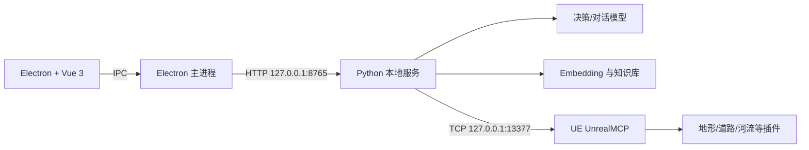

# LCAgent

LCAgent 是一个面向 Unreal Engine 场景构建的本地智能体系统。当前主界面采用 **Electron + Vue 3**，本地 **Python 服务**负责模型调用、工作区数据、知识检索和任务编排，并通过 UE 工程中的 **UnrealMCP** 插件与编辑器通信。

当前 UE 通信协议保持不变：Python 侧连接 `127.0.0.1:13377`，UnrealMCP 再调用地形、道路、河流等 UE 插件能力。



## 当前功能状态

- Electron 客户端：添加/移除工作区、模型选择、工作区对话、手动压缩上下文、删除对话、UE 资源读取、知识库建库/上传/检索。
- Python 服务：模型网关、上下文压缩、知识库、资源注册表、可审核目标规范、确定性观测计划、持久化运行记录和 UE 协议适配。
- Streamlit 管理控制台：新增或编辑模型与 Embedding、资源文件夹语义报告审核、智能体任务和诊断。
- UE 编辑器内不需要额外制作 LCAgent 面板；UE 只需启用并运行 UnrealMCP 插件。

> Electron 中的“任务”和“设置”仍在迁移。UE 资源页当前完成权威路径扫描与本地登记；需要模型生成文件夹用途报告并由用户审核时，仍使用 Streamlit 管理控制台。

## 1. 运行环境

当前版本面向 Windows，建议准备：

- Windows 10/11；
- Python 3.11～3.13（当前开发环境已在 Python 3.13.9 验证）；
- Node.js 22 或更高版本（当前开发环境为 Node.js 24.11.1）；
- Unreal Engine 5；
- Visual Studio 2022，并安装“使用 C++ 的游戏开发”以及对应 Windows SDK；
- Git（推荐使用 SSH，也可使用 HTTPS）。

检查基础环境：

```powershell
python --version
node --version
git --version
```

## 2. 下载源码

使用 Git：

```powershell
git clone https://github.com/yxy123123123123/LCAgent.git
cd .\LCAgent
```

已经配置 GitHub SSH 的用户也可以使用：

```powershell
git clone ssh://git@ssh.github.com:443/yxy123123123123/LCAgent.git
cd .\LCAgent
```

也可以从 GitHub 下载 ZIP，解压后在 PowerShell 中进入解压目录。下文以 `E:\LCAgent` 为示例，实际使用时请替换为自己的路径。

## 3. 安装 Python 依赖

在仓库根目录创建独立环境：

```powershell
cd E:\LCAgent
py -3.13 -m venv langchain_env
.\langchain_env\Scripts\python.exe -m pip install --upgrade pip
.\langchain_env\Scripts\python.exe -m pip install -r requirements.txt
```

如果电脑没有 Python 3.13，可将第一条命令改为 `py -3.11 -m venv langchain_env`。安装完成后验证：

```powershell
.\langchain_env\Scripts\python.exe -c "import streamlit, docx, pypdf; print('Python dependencies OK')"
```

## 4. 安装桌面客户端依赖

项目不要求全局安装 pnpm。使用固定版本即可：

```powershell
cd E:\LCAgent\desktop
npx --yes pnpm@11.19.0 install
```

仓库中的 `desktop/.npmrc` 已配置 Electron 镜像。如果安装阶段仍提示 Electron 下载失败，可在当前 PowerShell 窗口执行：

```powershell
$env:ELECTRON_MIRROR = "https://npmmirror.com/mirrors/electron/"
node .\node_modules\electron\install.js
Test-Path .\node_modules\electron\dist\electron.exe
```

最后一条命令返回 `True` 即表示 Electron 已就绪。无需再执行 `npm install`。

## 5. 安装 UE 插件

UE 插件单独维护在 [LandscapeTool-Plugins](https://github.com/yxy123123123123/LandscapeTool-Plugins) 仓库。仓库根目录对应 UE 工程的 `Plugins` 目录，其中包括 `UnrealMCP-master`、`Landscaping`、`RoadAuto`、`RiverAuto` 等插件。

如果是新 UE 工程，建议先把插件仓库克隆到临时目录，再将所需插件文件夹合并到 `<UE工程>\Plugins`，不要覆盖工程中已有的同名插件：

```powershell
git clone https://github.com/yxy123123123123/LandscapeTool-Plugins.git E:\Temp\LandscapeTool-Plugins
```

然后：

1. 关闭 UE 编辑器；
2. 把需要的插件复制到 `<UE工程>\Plugins`；
3. 使用 Visual Studio 2022 打开 UE 工程生成的 `.sln`；
4. 选择与工程一致的 Editor/Development 配置并编译；
5. 启动 UE，在“插件”中确认 UnrealMCP 及其依赖插件已启用；
6. 重启编辑器，使 UnrealMCP 开始监听 `127.0.0.1:13377`。

当前开发工程的可编辑插件位置是：

```text
E:\UE_project\LandscapeTool\Plugins
```

`E:\LCAgent\UnrealMCP-master` 仅用于历史版本对照，不再作为可编辑插件源码。

## 6. 启动 Electron 客户端

UE 相关操作需要先打开 UE 工程；仅进行模型对话、知识库管理或离线测试时可以不打开 UE。

```powershell
cd E:\LCAgent\desktop
npx --yes pnpm@11.19.0 dev
```

Electron 主进程会自动启动 `LCA/service.py`，默认服务地址为 `http://127.0.0.1:8765`。请保持启动终端处于打开状态。

默认会依次查找以下 Python：

1. 环境变量 `LCAGENT_PYTHON` 指定的解释器；
2. 仓库中的 `langchain_env\Scripts\python.exe`；
3. 仓库中的 `.venv\Scripts\python.exe`；
4. 系统命令 `python`。

如需使用其他虚拟环境，请在启动前指定：

```powershell
$env:LCAGENT_PYTHON = "D:\PythonEnvs\lcagent\Scripts\python.exe"
npx --yes pnpm@11.19.0 dev
```

启动后应能看到：

- Python 服务状态为正常；
- 可以添加或打开本地工作区；
- 可以移除工作区入口（不会删除磁盘上的工程和本地知识数据）；
- 下拉框能显示已经配置的对话模型；
- 对话区可以手动压缩上下文或删除当前工作区对话；
- 知识库页可以创建知识库、上传文档并测试检索；
- UE 已打开并启用插件时，连接信息类似“工程 LandscapeTool，契约 v1，能力 13 项”；
- UE 资源页可以读取 `/Game` 等包路径并显示真实资产对象路径；
- UE 未打开时显示“未连接”，不影响离线功能。

## 7. 启动配置与管理控制台

新增模型、配置 Embedding、生成并审核资源文件夹用途报告或运行状态机任务时，启动 Streamlit 管理控制台：

```powershell
cd E:\LCAgent
.\langchain_env\Scripts\python.exe -m streamlit run LCA\frontend_app.py --server.address localhost --browser.gatherUsageStats false
```

浏览器未自动打开时，访问 `http://localhost:8501`。也可运行：

```powershell
.\run_frontend.ps1
```

该脚本以无头方式启动，日志写入 `E:\LCAgent\streamlit.log`。

## 8. 运行测试

Python 离线测试不需要启动 UE，也不会实际执行地形创建：

```powershell
cd E:\LCAgent
.\langchain_env\Scripts\python.exe -m unittest discover -s tests -p "test_*.py"
```

桌面端静态检查与构建：

```powershell
cd E:\LCAgent\desktop
npx --yes pnpm@11.19.0 typecheck
npx --yes pnpm@11.19.0 build
```

## 9. 配置与数据安全

- API Key 保存在 `LCA/.env`，不要提交到 Git；
- 模型档案保存在 `LCA/model_profiles.local.json`；
- Embedding 档案保存在 `LCA/embedding_profiles.local.json`；
- 工作区知识库和注册表保存在 `.lca_data/workspaces/`；
- 场景目标草案、冻结目标和观测计划保存在 `.lca_data/workspaces/<workspace_id>/goals/`；
- 任务运行、连续事件和产物索引保存在 `.lca_data/lca.db`；
- 每次任务的完整轨迹产物保存在 `.lca_data/runs/<run_id>/artifacts/`；
- 本地对话记录保存在 `.codex_tmp/workspace_chats.json`；
- 资源注册表批准后还会写入 UE 工程的 `.lcagent/` 目录。

这些本地配置、密钥和运行数据已被 `.gitignore` 排除。首次公开仓库前仍应执行 `git status`，确认没有误提交真实密钥。

## 10. 后续文档

- [详细使用说明](docs/使用说明.md)
- [智能体架构技术方案](docs/智能体架构技术方案.md)
- [UEBox 风格 UE 通信协议第一版](docs/UEBox风格UE通信协议第一版.md)
