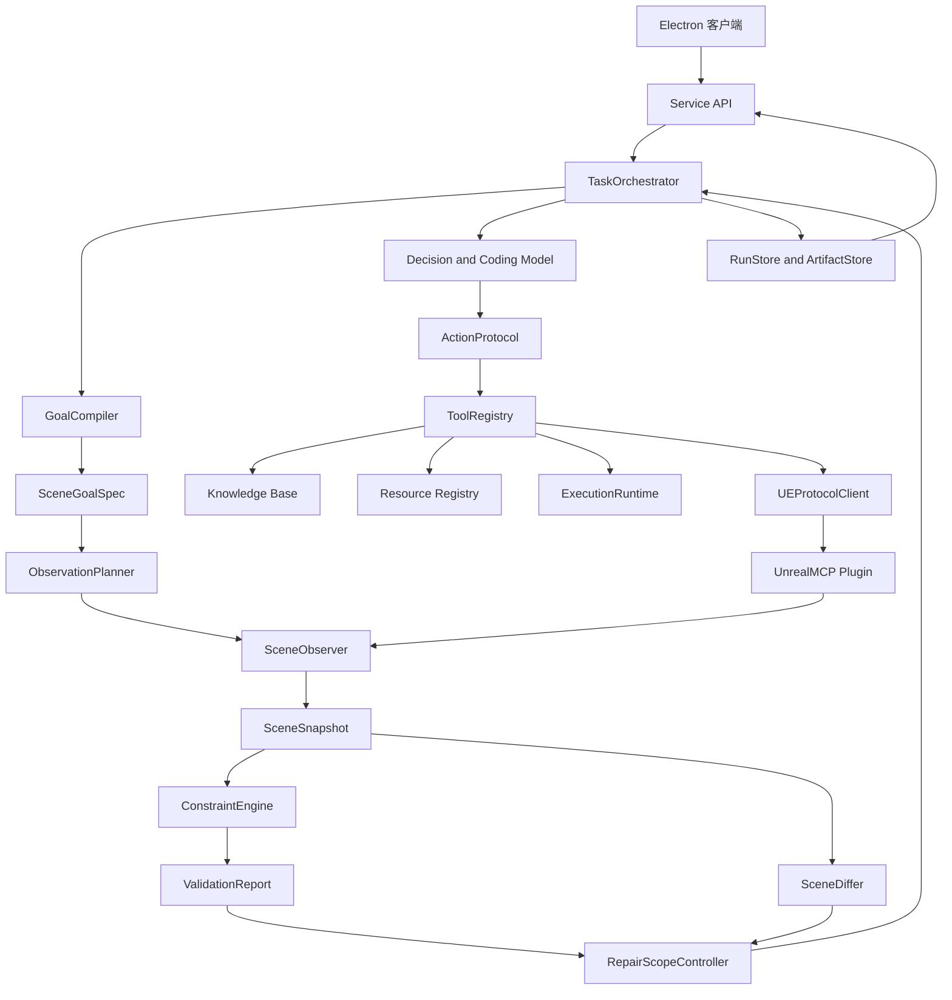
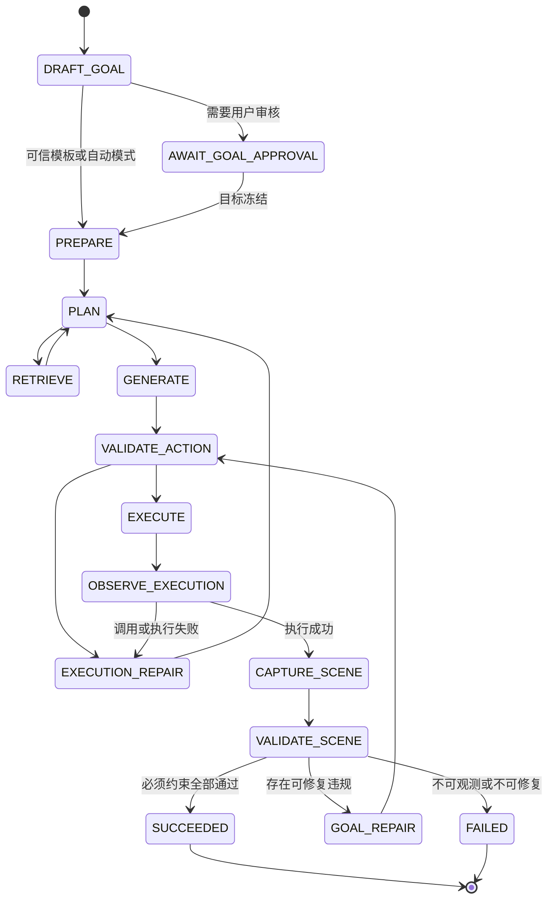

# LCAgent 总体优化与改造方案 v2

制定日期：2026-10-22

适用工程：`E:\LCAgent`

活动 UE 插件工程：`E:\UE_project\LandscapeTool\Plugins`

## 1 方案结论

LCAgent 下一阶段不应继续以“增加命令、增加提示词、让模型自行判断是否完成”为主要扩展方式，而应改造成一个由目标规范、权威场景观测、确定性验证和受约束局部修复共同驱动的 UE 场景构建系统。

本方案确定以下核心路线：

1. 保留一个能力较强的决策与编码模型。编码智能体仍然是场景构建主链路的一部分，负责理解需求、检索资料、规划动作、生成 Python 脚本和提出修复方案。
2. 保留一个 Embedding 模型，仅用于用户上传知识文档的向量化与检索，不再把资源注册表和用户上下文强行塞进同一个 RAG 架构。
3. 模型不再拥有任务成功的最终判定权。UE 命令返回成功只表示调用或执行成功，任务是否完成必须由真实场景快照和确定性约束验证决定。
4. 在现有 UE 通信协议上增量扩展，不推翻已经跑通的通信链。优先增加能力详情、通用只读场景查询、分页、字段投影、稳定实体标识和完整性说明。
5. 新增 `SceneGoalSpec`、`ObservationPlan`、`ValidationReport` 和依赖驱动的 `RepairScope`。其中，`ObservationPlan` 和 `RepairScope` 是本方案区别于普通“模型生成代码加工具反馈”系统的核心方法。
6. 首先用一个简单 Actor 属性任务跑通“执行、观测、验证、修复、再验证”的完整闭环，再以地形创建作为第一个真实垂直切片，之后扩展道路和河流。
7. 采用增量改造和阶段性提交。每一阶段必须具备独立测试和验收标准，不同时大改 Python、C++、服务端和前端。

最终主链路为：

```text
自然语言需求
  → SceneGoalSpec 草案
  → 用户确认或策略自动冻结
  → ObservationPlan
  → 决策与编码模型规划并生成脚本
  → ToolRegistry 校验和受控执行
  → UE 权威场景查询
  → SceneSnapshot
  → ConstraintEngine 确定性验证
  → ValidationReport 与 SceneDiff
  → 依赖驱动的 RepairScope
  → 编码模型实施局部修复
  → 重新观测和验证
  → 编排器产生最终结果
```

## 2 当前工程基线

### 2.1 已具备的能力

当前工程已经具备继续演进所需的基础，不建议推倒重写：

- `LCA/Agent.py` 已实现显式状态轨迹和单模型动作循环；
- `LCA/execution_runtime.py` 已具备脚本写入、AST 校验、受控目录和 dry-run/live 隔离；
- `LCA/model_gateway.py` 已支持可配置模型服务；
- `LCA/embedding_gateway.py` 与 `LCA/knowledge_base.py` 已形成知识文档上传、切片、向量化和检索基础；
- `LCA/context_compactor.py` 已承担对话上下文保存和压缩；
- `LCA/resource_registry.py`、`LCA/asset_registry_client.py` 和资源报告流程已形成 UE 权威扫描与用户审核的基本路径；
- `LCA/ue_protocol.py` 已支持能力握手、协议封装和旧协议回退；
- `LCA/service.py` 已向 Electron 客户端提供工作区、对话、资源扫描和知识库接口；
- Electron 客户端已具备工作区、模型配置、对话、资源和知识库等页面；
- 地形 Python 客户端到 UnrealMCP 再到 Landscaping 插件的基本调用链已经跑通；
- 当前活动 UE 插件已实现 `get_capabilities`、`get_scene_info` 和 `scan_project_assets`，握手可返回契约 v1 和 13 项能力。

### 2.2 当前主要缺口

当前系统能够判断动作 JSON、脚本和工具调用是否出错，但还不能可靠回答“UE 中的结果是否真正满足用户要求”。主要缺口如下：

1. `Agent.py` 同时承担动作定义、模型循环、工具调度、权限和状态推进，继续扩展会进一步耦合。
2. 动作清单同时存在于代码和提示词中，没有单一事实来源。
3. `/api/tasks` 仍是同步调用，缺少持久化 `run_id`、事件流、取消、恢复查询和实验导出。
4. 当前 `VALIDATE` 主要验证脚本，`OBSERVE` 主要读取工具结果，还没有任务级后置条件验证。
5. 当前 `get_scene_info` 字段有限且最多返回 1000 个 Actor，不支持通用过滤、字段投影和可靠分页。
6. 没有统一的场景快照、差异、约束求值和保护对象检查。
7. 模型可以通过输出 `finish` 结束任务，尚不能保证已经取得足够证据。
8. 活动 UE 插件中的系统能力和资源扫描代码尚未全部形成干净提交，协议实现与版本基线仍需冻结。
9. 当前工作树包含大量已有修改和未跟踪文件，任何重构都必须避免覆盖用户成果。

## 3 改造目标和非目标

### 3.1 改造目标

- 建立动作和工具的统一契约；
- 建立可持久化、可取消、可审计的任务运行生命周期；
- 从 UE 获取任务相关且完整性明确的权威场景状态；
- 将用户目标转换为可执行、可观测、可验证的场景约束；
- 用确定性程序区分通过、失败、不可观测和内部错误；
- 将失败转化为带证据、带边界的局部修复任务；
- 保留编码模型的灵活性，同时限制其写入范围和修复预算；
- 让地形、道路、河流等新能力以垂直切片方式接入，而不是再次修改主循环；
- 让工程运行记录可以直接支持测试复现和论文实验统计。

### 3.2 本阶段非目标

- 不增加第二个聊天大模型或独立执行智能体；
- 不把资源路径注册表改造成向量库；
- 不把用户上下文当作普通文档 RAG；
- 不引入 LoRA、VLM 或完整知识图谱作为首期依赖；
- 不构建全量持久化 UE 场景图数据库；
- 不一次性支持所有军事仿真规则；
- 不推翻现有 UE TCP 通信协议；
- 不承诺任意中断点恢复；
- 不在没有权威观测证据时把模型回答当作任务成功。

## 4 总体架构



### 4.1 分层职责

| 层 | 主要责任 | 不应承担的责任 |
|---|---|---|
| Electron | 配置、对话、目标审核、任务状态、报告展示 | 不直接访问 UE，不保存唯一业务状态 |
| Service API | 接口、鉴权边界、异步运行入口、事件查询 | 不在路由函数中实现编排规则 |
| TaskOrchestrator | 状态推进、预算、终止策略和模块协调 | 不硬编码地形或道路业务规则 |
| Decision and Coding Model | 意图理解、检索选择、计划、代码和修复建议 | 不判定最终成功，不决定自己的权限范围 |
| ToolRegistry | 工具契约、参数校验、能力和副作用检查 | 不决定任务下一步语义 |
| SceneObserver | 查询 UE 并标准化权威状态 | 不求值任务约束 |
| ConstraintEngine | 确定性求值和证据输出 | 不调用聊天模型，不补造缺失数据 |
| RepairScopeController | 计算允许修改范围、保护对象和复核集合 | 不替代模型编写全部修复代码 |
| RunStore | 保存运行、事件、产物和统计 | 不保存明文 API Key |

## 5 三类数据系统的重新定位

### 5.1 资源注册表

资源注册表不是语义向量库，而是当前 UE 工程的权威资产目录。

数据来源为 UE Asset Registry。系统在 UE 已连接时扫描 `/Game` 或用户选择的根目录，按文件夹形成层次报告，由模型辅助推测用途，用户审核后冻结为工作区资源注册表。生成代码时只能引用注册表中的资源路径。

建议保存内容包括：

- 包路径和对象路径；
- 资产类型和类路径；
- 所属文件夹层次；
- 模型建议用途和用户确认用途；
- 扫描时间、工程标识和插件版本；
- 资产是否仍存在、是否已变更；
- 用户审核状态。

注册表更新采用“重新扫描、计算差异、用户审核、生成新版本”的方式，不能静默覆盖已确认版本。

### 5.2 用户上下文

用户上下文用于保持对话连续性，不进入通用向量知识库。建议分成：

- 最近原始消息窗口；
- 自动压缩摘要；
- 用户显式固定的长期事实；
- 当前工作区状态引用；
- 已确认的目标规范和资源报告引用。

压缩摘要必须带版本、覆盖消息范围和生成模型信息。删除对话时，默认删除消息与摘要，但不自动删除用户明确保存的工作区资源注册表和知识库。

### 5.3 知识库

知识库是唯一使用 Embedding 模型的 RAG 子系统。用户可上传 PDF、DOCX、TXT 和 Markdown 文档，系统完成文本提取、切片、向量化、元数据记录和检索。

知识库主要向决策与编码模型提供：

- UE 和插件使用说明；
- 地理场景构建知识；
- 地形、道路、河流的参数和约束说明；
- 项目自定义操作规范；
- 用户认可的领域资料。

检索结果必须带文档、页码或段落来源、切片 ID 和相似度，不允许只返回无来源文本。

## 6 核心方法设计

### 6.1 SceneGoalSpec

`SceneGoalSpec` 是自然语言需求到执行和验证之间的结构化中间表示。核心结构保持场景无关，军事或地理场景字段放入 `domain_extensions`。

```json
{
  "goal_id": "goal_xxxx",
  "version": "1.0",
  "task_text": "...",
  "entities": [],
  "required_constraints": [],
  "optional_constraints": [],
  "protected_entities": [],
  "allowed_resources": [],
  "tolerances": {},
  "domain_extensions": {
    "battlefield": {}
  },
  "approval": {
    "status": "approved",
    "approved_at": "..."
  }
}
```

自然语言到 `SceneGoalSpec` 的转换可以使用决策模型，但模型生成的只是草案。对于 live 写入、实验任务或高影响操作，目标规范必须经过用户确认或由预先配置的可信模板冻结。确定性验证只能证明“冻结的约束是否满足”，不能证明模型最初提取的约束一定完整。

### 6.2 ObservationPlan

`ObservationPlan` 根据约束所需证据自动推导 UE 查询，而不是让模型每次随意决定读取什么。

```json
{
  "plan_id": "observation_xxxx",
  "goal_id": "goal_xxxx",
  "queries": [
    {
      "filter": {"entity_ids": ["entity_001"]},
      "fields": ["identity", "transform", "bounds"],
      "page_size": 200
    }
  ],
  "required_completeness": {
    "allow_truncated": false,
    "required_fields": ["identity", "transform", "bounds"]
  }
}
```

生成链为：

```text
ConstraintSet
  → required_observations
  → ObservationPlan
  → SceneQuery
  → SceneSnapshot
  → ValidationReport
```

这一设计有三个作用：减少大场景无关数据、避免模型漏查关键证据、使验证失败可以追溯到具体观测缺口。

### 6.3 标准场景快照和派生关系

第一阶段不构建完整持久化场景图数据库。系统保存标准 `SceneSnapshot`，并按当前任务从快照中派生临时关系图。

每个实体至少包含：

- 稳定实体 ID；
- Actor 名称、标签和类；
- 关卡或世界标识；
- 资源或类引用；
- Transform、Bounds 和 Tags；
- 父子关系和可选组件摘要；
- 字段来源和可观测性。

实体 ID 不应只使用可能被重命名的 Actor Name。优先使用 UE Actor GUID，并与关卡标识组合；若某类实体没有跨会话稳定 GUID，必须明确其稳定范围。

关系如相交、邻近、连接、包含、可达和可见由确定性计算或 UE 查询派生。每条关系必须记录证据、算法版本、参数和来源快照。

### 6.4 ConstraintEngine

约束引擎采用注册式 evaluator。第一阶段实现以下通用约束族：

1. 实体存在、数量和类型；
2. 属性等值、集合包含、数值范围和容差；
3. 资源引用有效性；
4. Transform 和 Bounds 的几何关系；
5. 保护对象保持不变。

随后为地理场景增加：

1. 碰撞与净空；
2. 连通与可达；
3. 可选的视线关系；
4. 后续的坡度和车辆通行能力。

每条约束只允许产生以下状态：`passed`、`failed`、`not_observable`、`error` 和 `skipped`。必须约束出现 `failed`、`not_observable` 或 `error` 时，任务不能成功。

### 6.5 依赖驱动的 RepairScope

修复范围不能由模型自行声明。程序根据失败约束、约束涉及实体、实体关系、允许工具和保护对象推导 `RepairScope`。

```json
{
  "repair_id": "repair_xxxx",
  "failed_constraints": ["c_001"],
  "allowed_entities": ["road_03"],
  "allowed_properties": ["spline.points", "transform"],
  "protected_entities": ["river_01", "camp_02"],
  "required_revalidation": ["c_001", "c_004", "c_007"],
  "remaining_budget": {
    "goal_repairs": 2,
    "tool_actions": 8
  }
}
```

修复后不能只验证原来失败的一项，还必须验证所有受修改影响的约束，并检查保护对象是否发生超容差变化。

## 7 编码智能体的保留方式

编码智能体不是被结构化工具替代，而是被纳入可验证、可审计的主链路。

编码模型继续负责：

- 根据目标和知识检索生成实施计划；
- 选择已注册工具；
- 为复杂地形、道路和河流任务生成 Python 脚本；
- 根据结构化违规证据编写局部修复代码；
- 向用户解释执行结果和失败原因。

程序负责限制：

- 模型输出必须符合 `ModelAction` Schema；
- 工具参数必须符合 `ToolSpec`；
- 生成脚本必须通过 AST 和路径检查；
- 脚本必须声明预期写集合；
- 运行时写操作不能超出工作区、资源注册表和 `RepairScope`；
- 模型不能通过输出 `finish` 绕过场景验证；
- 模型不能把自己的自然语言判断作为通过证据。

对于首次构建，可以允许编码模型生成较完整的 Python 脚本。对于任务级修复，优先使用参数明确的结构化修改工具；确需生成脚本时，脚本必须携带可机检的声明写集合，并在执行后通过真实场景差异验证。

## 8 动作协议与工具注册表

### 8.1 ToolSpec

每个工具只注册一次，提示词说明、参数校验、能力检查和运行调度都从注册表生成。

```json
{
  "name": "query_scene_state",
  "description": "按条件读取 UE 场景状态",
  "input_schema": "contracts/unreal_mcp/scene_query_request.schema.json",
  "output_schema": "contracts/unreal_mcp/scene_query_response.schema.json",
  "required_capabilities": ["scene.query.v1"],
  "effect": "read_only",
  "idempotent": true,
  "default_timeout_ms": 10000
}
```

副作用等级统一为：

- `read_only`：只读，可按策略安全重试；
- `local_write`：只写 LCAgent 受控目录；
- `ue_write`：修改 UE 场景；
- `external_write`：修改其他外部系统，首期禁用。

### 8.2 ModelAction

模型每一步只产生一个动作：

```json
{
  "action": "query_scene_state",
  "arguments": {},
  "rationale": "需要取得验证约束所需的真实状态"
}
```

`rationale` 只用于审计，不作为权限依据。

### 8.3 首批工具

- `search_assets`
- `search_knowledge`
- `write_script`
- `validate_script`
- `execute_script`
- `get_ue_capabilities`
- `query_scene_state`
- `capture_scene_snapshot`
- `validate_scene`
- `diff_scene`

其中后四项应主要由编排器自动调用，而不是完全依赖模型记得调用。

## 9 任务状态机和成功语义

### 9.1 三种成功

| 层级 | 含义 | 判定主体 |
|---|---|---|
| 调用成功 | 请求合法，工具或 Handler 正常返回 | 协议与工具适配器 |
| 执行成功 | 预期写操作已被 UE 接受和执行 | UE Handler 与执行层 |
| 任务成功 | 执行后真实场景满足全部必须约束 | ConstraintEngine 与 TaskOrchestrator |

### 9.2 两类修复

- `execution_repair`：处理 JSON、参数、脚本、工具和协议错误；
- `goal_repair`：处理工具执行成功但场景约束仍未满足的问题。

两类修复使用独立预算、事件类型和统计指标。

### 9.3 状态机



dry-run 的终止状态应为 `dry_run_completed`，表示动作和脚本已生成并通过静态检查，但不能表示 `goal_satisfied`。

结构化终止原因至少包括：

- `goal_satisfied`
- `dry_run_completed`
- `model_finished_without_verification`
- `constraint_failed`
- `not_observable`
- `tool_error`
- `budget_exhausted`
- `protocol_mismatch`
- `cancelled`

## 10 UE 协议改造

### 10.1 兼容策略

当前插件契约为 v1，Python 客户端也按 v1 工作。首期不直接硬切 v2，而是在 v1 上增加可选字段：

- `supported_contract_versions`
- `supported_protocol_versions`
- `capability_details`
- `plugin_version`
- `engine_version`
- `project_id`

客户端根据双方支持范围协商最高共同版本。旧插件继续走 legacy fallback，但所有降级和缺失能力必须进入运行记录。

### 10.2 query_scene_state

新增只读命令 `query_scene_state`，支持：

- 按实体 ID、名称、标签、类和任务标签过滤；
- 按 `fields` 选择返回字段；
- `page_size` 和 `cursor` 分页；
- `total_count`、`returned_count`、`next_cursor` 和 `truncated`；
- 对缺失字段返回 `missing_fields`，不填伪默认值；
- 返回单位、坐标系、关卡标识和实体 ID 稳定范围。

当前 `get_scene_info` 保留为兼容适配器，但其结果必须标记为字段受限，并且 Actor 上限不能被解释为完整场景。

### 10.3 超时和重试

只读且幂等的查询可以按明确策略重试。有副作用命令发生超时后，必须先查询真实状态，再决定是否重试，禁止盲目重复创建地形、道路或河流。

## 11 运行持久化和产物

建议使用 SQLite 保存运行元数据和事件索引，使用文件保存大型产物。这样比仅使用 JSONL 更适合 Electron、后台任务和并发读取。

```text
.lca_data/
  lca.db
  runs/
    run_xxxx/
      artifacts/
        goal_spec.json
        observation_plan.json
        model_step_0001.json
        generated_script_0001.py
        tool_observation_0001.json
        scene_snapshot_before.json
        scene_snapshot_after.json
        validation_0001.json
        scene_diff_0001.json
      manifest.json
```

SQLite 建议保存：

- `runs`
- `run_events`
- `artifact_index`
- `run_budgets`
- `run_metrics`

产物清单记录哈希、Schema 版本、生成时间和敏感字段脱敏状态。API Key、Authorization 和完整环境变量不得写入数据库、日志或产物。

## 12 建议新增模块

第一版在现有 `LCA` 目录内增量增加，暂不做大规模目录搬迁。

| 模块 | 责任 |
|---|---|
| `LCA/action_protocol.py` | 动作提取、Schema 校验和统一错误 |
| `LCA/tool_registry.py` | ToolSpec 注册、能力、副作用和调度 |
| `LCA/run_models.py` | TaskRun、RunEvent、状态和终止原因 |
| `LCA/run_store.py` | SQLite 运行记录和产物索引 |
| `LCA/goal_models.py` | SceneGoalSpec、约束和审批信息 |
| `LCA/goal_compiler.py` | 自然语言到目标草案及模板加载 |
| `LCA/observation_planner.py` | 约束到观测计划的确定性编译 |
| `LCA/scene_models.py` | SceneQuery、SceneSnapshot 和实体模型 |
| `LCA/scene_observer.py` | UE 查询、分页和标准化 |
| `LCA/scene_diff.py` | 带容差的结构化场景差异 |
| `LCA/constraint_engine.py` | evaluator 注册和验证报告 |
| `LCA/repair_controller.py` | RepairScope、预算和保护检查 |
| `LCA/task_orchestrator.py` | 新运行主循环 |

新增契约目录：

```text
contracts/
  agent/
    model_action.schema.json
    tool_observation.schema.json
  goal/
    scene_goal_spec.schema.json
    observation_plan.schema.json
    repair_scope.schema.json
  scene/
    scene_query.schema.json
    scene_snapshot.schema.json
    scene_diff.schema.json
    constraint_set.schema.json
    validation_report.schema.json
  unreal_mcp/
    capabilities.schema.json
    scene_query_request.schema.json
    scene_query_response.schema.json
```

现有 `DecisionAgent` 第一阶段作为兼容入口，内部逐步委托给新模块；新编排器稳定后，再将其缩减为兼容包装器。

## 13 服务接口和客户端功能

### 13.1 服务接口

建议新增：

```text
POST /api/runs
GET  /api/runs/{run_id}
GET  /api/runs/{run_id}/events?after_sequence=N
POST /api/runs/{run_id}/cancel
GET  /api/runs/{run_id}/artifacts
POST /api/goals/draft
POST /api/goals/{goal_id}/approve
GET  /api/ue/capabilities
POST /api/ue/scene/query
POST /api/scene/validate
```

现有 `/api/tasks` 保留为兼容入口，内部创建 run。长任务改为异步运行，客户端使用事件轮询或本地流式通道读取进度。

### 13.2 Electron 客户端

在现有工作区界面中增加任务页，而不是重建一套 UI：

- 目标规范草案和审核；
- dry-run/live 模式；
- UE 连接、工程、协议和插件版本；
- 当前运行阶段和事件时间线；
- 模型步骤、工具动作和剩余预算；
- 脚本静态校验状态；
- 场景观测完整性；
- 约束通过、失败和不可观测数量；
- 修复范围、修复次数和场景差异；
- 取消运行和导出实验包。

界面必须清楚区分“脚本合法”“UE 执行成功”和“场景目标通过”。

## 14 分阶段实施计划

### M0 冻结双工程基线

工作内容：

- 保存 LCAgent 和活动插件仓库的提交、分支和工作树清单；
- 提交或以明确方式保留当前活动插件中的能力握手和资源扫描代码；
- 确认 `E:\LCAgent\UnrealMCP-master` 只用于历史对比，不再编辑；
- 运行现有 Python 测试、Electron typecheck 和 build；
- 保存真实 UE 的能力响应、资源扫描和场景查询样例；
- 建立 Python 客户端、协议文档和 C++ Handler 的能力矩阵。

验收：两个仓库都有可恢复基线；现有测试结果可重复；13 项能力的来源和版本明确。

### M1 动作契约和工具注册表

工作内容：

- 实现 `ModelAction`、`ToolSpec` 和统一错误码；
- 注册现有检索、脚本和 UE 工具；
- 从 ToolRegistry 生成提示词动作说明；
- 保留现有动作常量的兼容层。

验收：新增工具只注册一次即可进入提示词、校验和调度；现有行为不变。

### M2 运行生命周期和持久化

工作内容：

- 实现 TaskRun、RunEvent、预算、取消和 SQLite RunStore；
- 改造 `/api/tasks` 为兼容包装；
- 新增 run 查询和产物接口；
- 将长任务从同步请求中拆出。

验收：服务重启后仍能查询历史运行；取消后不再触发新模型或写操作。

### M3 目标规范和观测计划

工作内容：

- 实现 `SceneGoalSpec` Schema、草案生成和审核冻结；
- 实现通用约束声明；
- 根据 `required_observations` 编译 `ObservationPlan`；
- 先使用固定 JSON 样例和假 UE 完成测试。

验收：给定同一约束集能稳定生成同一观测需求；缺少必要字段时明确失败。

### M4 UE 通用只读场景查询

工作内容：

- 增量扩展能力协商；
- 在 C++ 插件中实现 `query_scene_state`；
- 支持过滤、字段投影、分页、完整性和稳定实体 ID；
- 保留 `get_scene_info` fallback。

验收：大场景不会静默截断；静态场景重复查询的关键字段一致；只读查询不修改场景。

### M5 快照和差异

工作内容：

- 标准化 SceneSnapshot；
- 实现哈希、单位、坐标系和可观测性；
- 实现实体对齐、数值容差和保护对象差异。

验收：静态场景差异为空；只修改一个 Actor 时只报告相关实体和属性；查询不完整时结果为 `inconclusive`。

### M6 确定性约束引擎

工作内容：

- 实现 evaluator 注册机制；
- 首批实现实体、数量、属性、引用和保护对象约束；
- 输出带测量值、期望值和证据引用的 ValidationReport。

验收：通过、失败、字段缺失、查询截断和求值异常均有稳定结果；模型无法影响验证结果。

### M7 编排和受约束修复

工作内容：

- 实现新 TaskOrchestrator；
- 分离 execution_repair 与 goal_repair；
- 实现依赖驱动 RepairScope、写集合检查和预算；
- 修复后自动重查、计算差异并复核相关约束。

验收：模型不能输出 `finish` 绕过验证；越权修复在执行前被拒绝；循环必然在预算内终止。

### M8 客户端任务面板

工作内容：

- 增加目标审核、运行状态、事件、验证报告、差异、取消和导出；
- 保留现有对话、资源、模型和知识库页面；
- Streamlit 仅作为调试入口，不复制完整业务逻辑。

验收：客户端关闭再打开仍可读取任务历史；每个成功状态都能定位到验证报告。

### M9 垂直切片扩展

实施顺序：

1. Actor X 坐标 smoke test：故意不满足约束，一次修复后通过；
2. 地形创建：文件、材质、Actor 存在和关键属性验证；
3. 道路创建：Spline、资源、连接和避让验证；
4. 河流创建：Spline、水体对象、地形关系和必要净空验证；
5. 组合场景：检查道路、河流和地形之间的约束与保护对象。

每个垂直切片必须同时包含 Schema、Python 客户端、UE Handler、验证器、自动测试、真实 UE 测试清单和一次独立提交。

## 15 测试和协作分工

### 15.1 可由开发环境自动完成

- 模型动作和 JSON Schema 测试；
- 生成 Python 脚本的 AST、安全边界和声明写集合测试；
- 生成 JSON 是否符合命令契约；
- ToolRegistry、RunStore、ObservationPlan、Snapshot、Diff、Constraint 和 RepairScope 单元测试；
- 假模型网关与假 UE 服务器的端到端测试；
- Python 与 C++ 共用固定 JSON 的契约测试；
- Electron typecheck 和 build；
- 运行产物、日志脱敏和服务重启读取测试。

### 15.2 需要用户完成

- 使用 VS2022 编译 UE 插件；
- 启动 UE 并确认插件加载；
- 在真实关卡中执行只读查询和写入 smoke test；
- 观察地形、道路和河流的实际效果；
- 把编译错误、UE 日志和不符合预期的场景结果反馈回来。

### 15.3 双方联合完成

- 将生成的 JSON 与实际 Handler 参数逐字段对照；
- 确认 UE 返回字段、单位和实体 ID 稳定性；
- 确认约束阈值和任务通过标准；
- 对真实 UE 中出现但自动测试未覆盖的问题补充固定样例和回归测试。

## 16 论文方法和实验对应

本工程建设中，工具注册、协议统一、运行持久化和 UI 属于支撑系统；论文方法重点应落在：

- `SceneGoalSpec`：把自然语言目标转为可执行约束；
- `ObservationPlan`：从约束确定性推导任务相关观测；
- `ConstraintEngine`：依据 UE 权威状态产生可归因证据；
- `RepairScopeController`：根据失败依赖限制局部修复并保护未要求修改的对象。

建议对照组保持相同的编码模型、模型配置、资源注册表和任务集，只改变验证与修复机制：

| 配置 | 机制 |
|---|---|
| B0 | 一次生成并执行，无场景后置验证 |
| B1 | 有执行日志反馈，无结构化约束验证 |
| B2 | 有目标规范和结构化验证，无局部修复 |
| Ours | 目标规范、ObservationPlan、结构化证据和受约束局部修复 |

建议优先消融：

- 全量场景状态与任务相关 ObservationPlan；
- 普通失败文本与结构化违规证据；
- 不受限修复与依赖驱动 RepairScope；
- 全局重生成与局部修复；
- 无保护对象检查与有保护对象检查。

不建议把“结构化状态与截图”设为首期必做消融，除非已经实现同等级 VLM，因为两者会同时改变模型、模态、成本和可观测范围，难以形成公平比较。

核心指标：

- 任务约束满足率；
- 未要求修改对象保持率；
- 错误检出率、漏检率和误报率；
- 修复成功率和平均修复轮次；
- 场景差异规模；
- 模型调用数、工具动作数、时间和 API 成本；
- `not_observable` 比例和原因分布。

## 17 版本管理和提交策略

LCAgent 与 UE 插件保持两个独立 Git 仓库。

- LCAgent：`E:\LCAgent`
- UE 插件：`E:\UE_project\LandscapeTool\Plugins`
- 历史参考：`E:\LCAgent\UnrealMCP-master`，只读，不再作为开发版本

建议提交门：

1. `baseline and existing capabilities`
2. `tool registry and action contracts`
3. `run lifecycle and persistence`
4. `goal spec and observation plan`
5. `scene query and snapshots`
6. `constraint engine and repair scope`
7. `actor closed loop smoke test`
8. `terrain vertical slice`
9. `road vertical slice`
10. `river vertical slice`

每次提交前至少满足对应自动测试。C++ 提交由用户完成编译验证后再标记为可用基线。禁止使用 `git reset --hard`、`git checkout --` 或批量删除清理当前工作树。

## 18 主要风险和控制措施

| 风险 | 影响 | 控制措施 |
|---|---|---|
| 目标约束提取不完整 | 验证通过但不符合真实意图 | 目标草案审核、模板、版本冻结 |
| UE 查询字段不足 | 大量 not_observable | ObservationPlan 驱动能力补齐 |
| Actor 标识不稳定 | 快照无法可靠对齐 | Level ID 加 Actor GUID，记录稳定范围 |
| 大场景返回过大 | 延迟和上下文膨胀 | 过滤、字段投影、分页和任务相关观测 |
| 生成脚本越权 | 破坏无关对象 | AST、注册表、声明写集合和运行后差异 |
| 写命令超时后重复执行 | 重复创建对象 | 先查询真实状态，再决定是否重试 |
| 修复影响已通过约束 | 局部修复造成回归 | 依赖分析和受影响约束复核 |
| 多轮循环失控 | 成本和时间不可控 | 模型、动作、修复、时间和费用预算 |
| 两套前端逻辑分叉 | 维护成本升高 | 业务逻辑全部放在 Service 和核心模块 |
| 插件源码未提交 | 无法复现 | M0 先冻结活动插件基线 |

## 19 完成定义

满足以下条件后，LCAgent 通用优化阶段才算完成：

1. 工具动作具有唯一 Schema 来源；
2. 每个任务都有持久化 run、事件、预算和产物；
3. 自然语言目标可以生成并冻结 SceneGoalSpec；
4. 约束能够自动编译成 ObservationPlan；
5. UE 支持带过滤、投影、分页和完整性说明的只读场景查询；
6. 场景快照和差异可以稳定复现；
7. 约束引擎能区分通过、失败、不可观测和错误；
8. 模型不能绕过验证宣布成功；
9. 修复范围由程序推导，越权写入在执行前被拒绝；
10. 保护对象变化会阻止任务成功；
11. 假 UE 端到端闭环和真实 UE Actor smoke test 均通过；
12. 地形垂直切片完成后再扩展道路和河流；
13. Python 测试、Electron typecheck/build 和插件编译均通过；
14. 运行产物能够复现一次任务，并可直接导出用于实验统计。

## 20 建议立即执行的第一批工作

第一批只完成 M0 和 M1，不修改场景业务逻辑：

1. 冻结 LCAgent 与活动插件当前基线；
2. 保存现有 65 项 Python 测试和 Electron 构建结果；
3. 提交活动插件中已经可用的能力握手、协议封装和资源扫描代码；
4. 建立现有 13 项 UE 能力矩阵；
5. 新增 ActionProtocol、ToolRegistry 和首批 Schema；
6. 将现有动作接入注册表，同时保持 `/api/tasks` 和 DecisionAgent 行为兼容；
7. 补齐动作、参数、能力、副作用和回归测试；
8. M1 独立提交并验收后，再进入运行持久化和场景观测阶段。

这一顺序能先降低接口漂移和版本不可复现风险，再建设验证闭环，不会因为同时改动模型、协议、插件和 UI 而难以定位问题。
