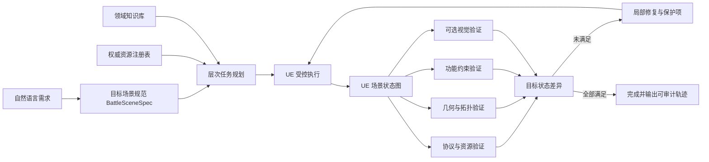

# 场景构建智能体深挖方向：文献启发与候选路线（v1）

更新日期：2026-10-21

## 一、扫描范围与结论边界

本轮是面向研究选题的定向空白扫描，不是完整系统综述。检索对象包括本地保存的 3D-GPT、SceneCraft、AgentBench、ReAct 等全文，以及 2023—2026 年官方论文页和 arXiv 原文。重点检索以下主题：

- LLM/VLM 场景构建智能体；
- 场景图、层次规划和空间推理；
- 视觉、几何、物理和功能反馈；
- 连续场景编辑与最小变更；
- 可执行场景语言、前置条件和后置条件；
- 多轮行动后的空间状态维护与评价。

当前结论只能表述为“在本轮定向检索范围内未发现完全相同的问题组合”，不能表述为“国内外首次”。

## 二、文献带来的关键判断

### 2.1 已经较为拥挤、不能单独作为创新的方向

1. **多智能体分工构建 3D 场景**：3D-GPT、VULCAN、ChatSim 等均已有相关设计。
2. **LLM/VLM 调用 Blender 或 MCP 工具**：SceneCraft、3D-GPT、VULCAN、SAGE、SceneAssistant 已覆盖。
3. **一般性的视觉反馈闭环**：SceneCraft、SceneAssistant、VULCAN 已明确使用渲染反馈或视觉工具进行迭代修改。
4. **一般性的场景图或层次场景表示**：SceneCraft、SayPlan、TreeSearchGen、Spatially Contextualized VLMs、RieMind 均已研究。
5. **普通 RAG 或技能库**：SceneCraft 已包含函数技能库，RAG 也已广泛应用于场景规划。

因此，本论文不能把“多智能体、场景图、视觉反馈、MCP、RAG”本身称为创新。

### 2.2 仍值得深挖的研究问题

1. 场景是否满足**可执行的目标状态**，而不仅是渲染结果看起来合理。
2. 场景是否满足**任务功能约束**，例如可通行、可到达、具有指定净空或视线关系。
3. 多轮修改后，智能体是否保持了正确的空间状态，是否意外破坏了未要求修改的对象。
4. 大规模室外环境如何进行层次分解、局部规划和局部修复，而不是整体重新生成。
5. 如何把 UE 返回的结构化状态、几何检测、功能检测和可选视觉反馈组合为可归因的修复依据。

## 三、重点文献启发

| 文献 | 已有机制 | 对本课题的启发 | 不能重复声称的内容 |
|---|---|---|---|
| 3D-GPT | 三智能体、程序化建模、连续编辑 | 前期多智能体方案和连续指令基线 | 多智能体分工本身 |
| SceneCraft | 场景图、空间约束、视觉反馈、技能库 | 约束级评价和可复用工具函数 | 场景图、视觉反思、技能库本身 |
| SayPlan | 层次 3D 场景图、相关子图检索、迭代重规划 | 大规模环境只向模型暴露任务相关局部状态 | 层次场景图本身 |
| TreeSearchGen | 层次场景分解、全局—局部搜索、失败回溯 | 场景构建不应只用不可回退的线性生成 | 一般树搜索与层次布局 |
| Spatially Contextualized VLMs | 场景描述、点云、超图组成持续更新的空间上下文 | 为智能体维护显式、可查询的场景工作记忆 | 一般空间上下文本身 |
| RieMind | 通过结构化几何工具查询尺寸、距离、姿态和关系 | UE 结构化状态可能比纯截图更可靠 | 结构化 3D 场景图本身 |
| SceneAssistant | 原子操作 API、视觉反馈、碰撞反馈、人机协同编辑 | 操作原语和反馈需要完整且可验证 | 视觉反馈闭环本身 |
| VULCAN | MCP、视觉工具、规划—执行—验证多智能体 | 验证应成为独立可测环节 | MCP 加验证智能体本身 |
| SAGE | 语义、视觉和物理 critic；模拟器在环 | 将物理/功能检测作为场景验收依据 | 普通多 critic 架构 |
| SpatialGrammar | 场景 DSL、确定性编译、碰撞约束、编译反馈修复 | 用中间表示把自然语言变成可验证约束 | “首次提出场景 DSL” |
| Edit-As-Act | 目标回归规划、前置/后置条件、最小编辑、保持未编辑内容 | 将连续编辑改写为“达到目标状态的最小动作序列” | 一般目标回归与最小编辑 |
| SpatialAct | 多轮行动中存在明显的推理—行动差距和状态维护失败 | 构建状态保持、单步修复和多轮修改基准 | 一般空间智能体基准 |
| iARCS | 步行性、可达性和净空等任务功能约束 | 从视觉正确进一步转向任务可用 | 一般功能约束优化 |

## 四、候选研究方向

评分采用 1—5 分，表示当前定向文献扫描下的相对判断，不代表已经验证。

| 候选方向 | 学术辨识度 | 与 LCAgent 契合度 | 实现可行性 | 实验可验证性 | 判断 |
|---|---:|---:|---:|---:|---|
| A. 任务功能约束驱动的场景验证与修复 | 5 | 5 | 4 | 5 | 最推荐 |
| B. 目标状态驱动的增量编辑与未修改内容保持 | 4 | 5 | 4 | 5 | 推荐 |
| C. 层次战术场景图与局部规划/局部修复 | 4 | 5 | 3 | 4 | 推荐但需限规模 |
| D. 面向战术地理环境的可执行场景规范语言 | 4 | 4 | 3 | 5 | 可与 A/B 合并，不宜单独做大 |
| E. 结构化状态与多视图视觉联合感知 | 3 | 4 | 3 | 3 | 可作为增强，不宜做唯一主线 |
| F. 成功轨迹技能库与持续自改进 | 2 | 4 | 4 | 3 | 近邻工作较多，优先级低 |
| G. 动态工具发现与插件能力自适应 | 3 | 5 | 4 | 4 | 工程价值高，可作为支撑机制 |

## 五、最推荐的组合路线

不建议同时新增七个方向。最连贯的组合是：

> **目标状态表达 + UE 场景状态图 + 多级功能验证 + 差异驱动的局部修复。**

### 5.1 目标场景规范

把用户自然语言转换为结构化 `BattleSceneSpec`，至少包含：

- 实体：地形、道路、河流、建筑、植被、军事设施；
- 资源约束：允许使用的 UE 资产类型和路径；
- 几何约束：位置、距离、方向、范围、数量、不得相交；
- 拓扑约束：连接、包含、邻接、穿越、避让；
- 功能约束：可达性、可通行性、净空、视线；
- 编辑保护项：本轮不得改变的对象和属性；
- 完成条件：用于自动判定任务是否成功的后置条件。

这不是为了发明一种庞大语言，而是给智能体一个可执行、可检查的中间表示。

### 5.2 UE 场景状态图

从 UE 查询当前场景状态并维护图结构：

- 节点：区域、Actor、资产、道路段、河流段等；
- 属性：类型、Transform、边界框、材质、标签、存在状态；
- 关系：相交、邻近、连接、位于、可见、可达；
- 版本：每次动作前后记录状态差异。

模型不直接读取整个 UE 工程，只获取与当前目标相关的子图和验证结果。

### 5.3 多级验证器

建议按确定性优先的顺序设置：

1. 协议验证：动作和参数是否合法；
2. 资源验证：对象路径是否存在且被授权；
3. 几何验证：数量、位置、边界、碰撞和距离是否满足；
4. 功能验证：可达性、通行性、净空、视线等是否满足；
5. 视觉验证：仅处理结构化检测难以覆盖的整体合理性和外观问题。

### 5.4 差异驱动的局部修复

验证器不只返回“失败”，还返回反例：

```json
{
  "constraint": "road_connects(zone_a, zone_b)",
  "status": "failed",
  "evidence": "zone_b endpoint distance = 132.4 m",
  "suggested_scope": ["road_03"],
  "protected_objects": ["river_01", "camp_02"]
}
```

智能体据此只修改失败相关对象，并验证未修改对象是否保持不变。

## 六、建议控制的功能约束范围

为了符合硕士论文工作量，不应一开始实现完整军事规则。建议只选择 3—4 类可由 UE 自动判断的约束：

1. **对象与属性完整性**：数量、类型、位置和资源路径；
2. **非碰撞与净空**：边界框相交、道路或设施周围安全距离；
3. **连通与可达**：道路拓扑连接、NavMesh 或路径搜索可达；
4. **视线关系**：利用 UE Line Trace 验证观察点与目标点可见或受遮挡。

坡度与车辆通行能力可作为后续扩展，前提是当前 UE 工具能稳定取得地形高程与法向。

## 七、可以形成的论文研究问题

- RQ1：显式目标场景规范能否提高自然语言需求到 UE 动作计划的约束完整性？
- RQ2：结构化 UE 状态图与多级验证是否比仅依赖执行返回或截图反馈更准确地发现场景错误？
- RQ3：差异驱动的局部修复是否能在提高任务完成率的同时减少无关对象变化、动作数和 API 成本？
- RQ4：层次场景分解是否能提高复杂复合场景的构建成功率，并控制上下文与规划开销？

中期前建议优先验证 RQ1—RQ3；RQ4 可先在一个复合任务上做可行性展示，毕业论文阶段再扩展。

## 八、对应实验

### 8.1 对照组

| 配置 | 特征 |
|---|---|
| B0 | 一次性生成并执行，无场景验证 |
| B1 | ReAct/执行日志反馈，无结构化场景后置条件 |
| B2 | 有场景规范与结构化状态验证，无局部修复 |
| Ours | 场景规范 + 多级验证 + 差异驱动局部修复 |

### 8.2 关键消融

- 去掉功能验证，只保留工具 `success/error`；
- 去掉场景状态图，只使用截图；
- 去掉保护项，允许整体重生成；
- 去掉局部修复，失败后重新规划整个场景；
- 可选：去掉层次分解，比较复杂场景表现。

### 8.3 指标

- 任务完成率与各类约束满足率；
- 错误检出率、漏检率和误报率；
- 修复成功率和平均修复轮次；
- 未要求修改对象的保持率；
- 场景状态差异规模；
- 模型调用数、总动作数、耗时与 API 成本；
- 复杂任务中的上下文长度和失败位置分布。

## 九、概念工作图

由于当前环境未配置科学示意图生成服务所需密钥，本轮用可编辑 Mermaid 图记录概念关系，后续制作论文图时再转为正式矢量图。



## 十、暂定判断

最值得继续讨论的不是再增加一个“视觉智能体”或“检索智能体”，而是把场景构建从开放式代码生成转化为：

> **由目标状态约束、权威场景状态、多级验证器和局部修复共同驱动的可验证场景构建过程。**

这条路线能够继承现有 LCAgent 的资源注册、状态机、安全执行和 UE 通信，又能把论文创新从通用智能体工程推进到场景构建特有的空间、功能和增量编辑问题。

## 十一、正式来源入口

- SceneCraft: https://proceedings.mlr.press/v235/hu24g.html
- 3D-GPT: https://arxiv.org/abs/2310.12945
- SayPlan: https://proceedings.mlr.press/v229/rana23a.html
- Global-Local Tree Search: https://arxiv.org/abs/2503.18476
- Agentic 3D Scene Generation with Spatially Contextualized VLMs: https://arxiv.org/abs/2505.20129
- SceneAssistant: https://arxiv.org/abs/2603.12238
- RieMind: https://arxiv.org/abs/2603.15386
- SpatialGrammar: https://arxiv.org/abs/2604.27555
- SpatialAct: https://arxiv.org/abs/2605.31148
- iARCS: https://arxiv.org/abs/2608.06161
- VULCAN: https://openaccess.thecvf.com/content/CVPR2026/html/Kuang_VULCAN_Tool-Augmented_Multi_Agents_for_Iterative_3D_Object_Arrangement_CVPR_2026_paper.html
- SAGE: https://openaccess.thecvf.com/content/CVPR2026/html/Xia_SAGE_Scalable_Agentic_3D_Scene_Generation_for_Embodied_AI_CVPR_2026_paper.html
- Edit-As-Act: https://openaccess.thecvf.com/content/CVPR2026/html/Noh_Edit-As-Act_Goal-Regressive_Planning_for_Open-Vocabulary_3D_Indoor_Scene_Editing_CVPR_2026_paper.html
- MANSION: https://openaccess.thecvf.com/content/CVPR2026/html/Che_MANSION_Multi-floor_lANguage-to-3D_Scene_generatIOn_for_loNg-horizon_tasks_CVPR_2026_paper.html
